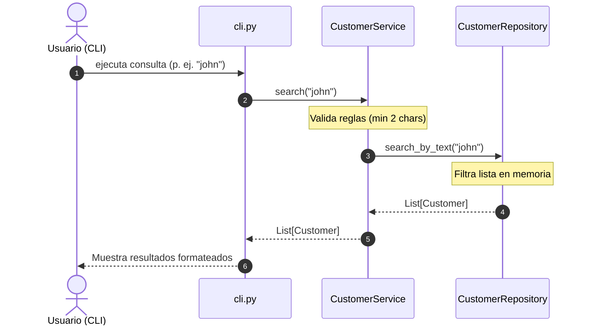

# Architecture

## Overview
The feature follows a simple 3-layer modular architecture: CLI Interface Layer, Core Business/Domain Layer, and In-Memory Repository Layer.

## Components
1. **`cli.py` / Entry point:** Handles user input/output, command-line arguments, and error formatting.
2. **`service.py` (`CustomerService`):** Orchestrates validation rules and delegates search execution.
3. **`repository.py` (`CustomerRepository`):** Holds in-memory customer data and performs filtering.
4. **`models.py` (`Customer`):** Dataclass representing the customer entity.
5. **`exceptions.py`:** Custom application errors (`ValidationError`).

## Responsibilities
- **`models.py`**: Ensures data integrity of individual customer objects.
- **`repository.py`**: Isolates data storage logic; provides a clean `find_by_query(query)` interface.
- **`service.py`**: Applies input validation before querying repository.
- **`cli.py`**: Formats output for terminal interaction.

## Data Flow

## Interfaces
- `CustomerService.search(query: str) -> list[Customer]`
- `CustomerRepository.search_by_text(query: str) -> list[Customer]`

## Error Handling
- Validation errors are raised as `ValidationError` exceptions in the service layer and handled by `cli.py` to display friendly message outputs.

## Testing Strategy
- Unit testing for `CustomerService` (validation logic, search rules).
- Unit testing for `CustomerRepository` (filtering logic, edge cases).
- CLI integration testing capably checking stdout/stderr outputs.

## Dependencies
- Standard Library: `dataclasses`, `typing`, `sys`, `argparse`.
- Development/Testing: `pytest`, `pytest-cov`.

## Design Decisions
- **Dataclasses for Models:** Lightweight, type-annotated, standard library compliant.
- **In-Memory Repository Pattern:** Separates persistence concerns, making future DB integration trivial.

## Trade-offs
- No persistent storage: Data resets on each invocation. Acceptable per C-01 and A-01 requirements.