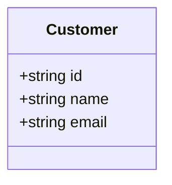

# Customer Search Feature

## Goal
Provide a reliable, validated, case-insensitive partial search mechanism to locate customer records by name or email via a local CLI/Python module.

## Requirements Covered
- FR-01
- FR-02
- FR-03
- FR-04
- FR-05
- FR-06
- NFR-01
- NFR-02
- NFR-03

## Scope
- In-memory data repository seeded with customer records.
- Core domain logic for searching, normalizing input, and validating query rules.
- Local CLI entry point to accept user search queries and print formatted results.
- Automated unit and integration test suite using pytest.

## Out of Scope
- HTTP REST API endpoints / FastAPI framework (reserved for future iterations).
- External database connection (SQL/NoSQL).
- Authentication, authorization, or role-based access control.

## Domain Model

## Search Rules
1. Query string is trimmed of leading and trailing whitespaces.
2. Search matching is case-insensitive (`query.lower() in field.lower()`).
3. Query matches if substring exists in either `Customer.name` OR `Customer.email`.
4. Maximum returned records: 50 items per search.

## Validation Rules
1. If `len(trimmed_query) < 2`: Raise `ValidationError` with message `"Search query must be at least 2 characters long."`
2. If `trimmed_query` is empty or only whitespace: Raise `ValidationError` with message `"Search query cannot be empty."`

## Error Handling
- Custom exception `ValidationError` is caught by the CLI layer and rendered gracefully to stderr or stdout without crashing the script execution.

## Acceptance Criteria
- Given a query `"john"`, when searching, then records containing `"John"`, `"johnny"`, or `"john@mail.com"` are returned.
- Given a query `"  a  "`, when searching, then a `ValidationError` is raised due to query length < 2.
- Given a query `"xyz_nonexistent"`, when searching, then an empty list is returned without throwing errors.

## Test Scenarios
1. **Successful partial match by name:** Query `"al"` returns `"Alice"` and `"Alex"`.
2. **Successful partial match by email:** Query `"gmail"` returns all customers with Gmail addresses.
3. **Case insensitivity verification:** Query `"DOE"` returns `"Jane Doe"`.
4. **Invalid query length:** Query `"a"` raises `ValidationError`.
5. **Whitespace-only query:** Query `"   "` raises `ValidationError`.
6. **No matches found:** Query `"99999"` returns `[]`.

## Constraints
- Python 3.11+ without external database drivers.

## Open Questions
- N/A - Scope and rules are fully defined.